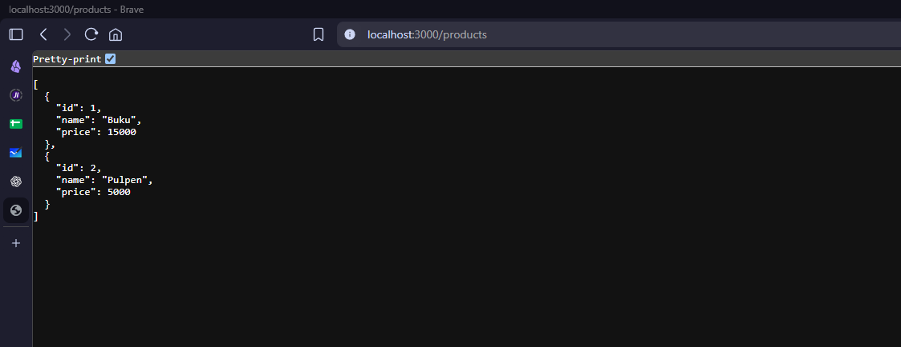
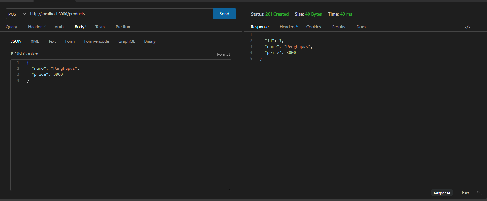
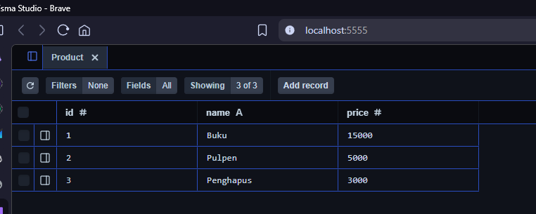
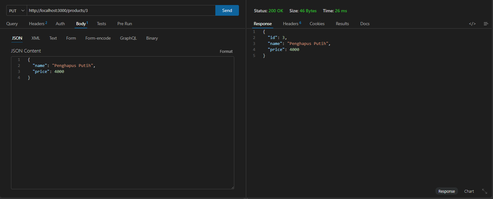
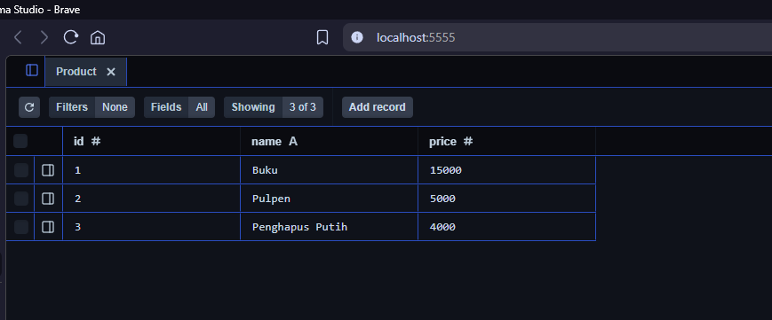
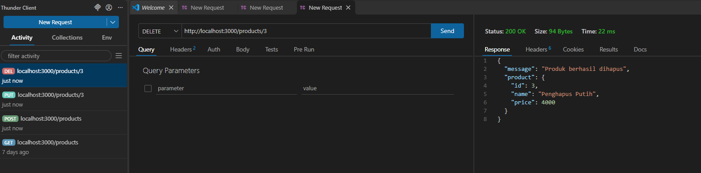
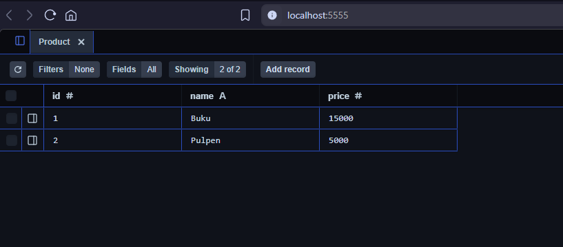
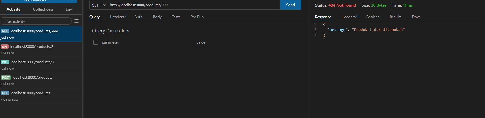
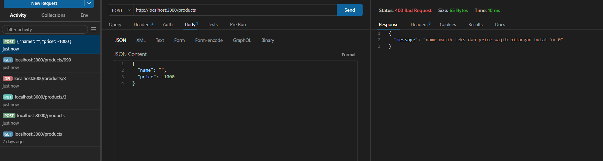

# Bukti Pengujian CRUD Prisma

Dokumentasi pengujian REST API menggunakan **Express.js, Prisma ORM, SQLite, dan Thunder Client**.

## 1. GET - Menampilkan Semua Produk

**Endpoint:** `GET /products`  
**Status:** 200 OK

## 2. POST - Menambahkan Produk

**Endpoint:** `POST /products`  
**Status:** 201 Created

Data yang ditambahkan:
- Nama: Penghapus
- Harga: 3000

### Database Setelah POST

Produk baru berhasil tersimpan di database Prisma.

## 3. PUT - Memperbarui Produk

**Endpoint:** `PUT /products/3`  
**Status:** 200 OK

Perubahan data:
- Nama: Penghapus menjadi Penghapus Putih
- Harga: 3000 menjadi 4000

### Database Setelah PUT

Data produk berhasil diperbarui pada database.

## 4. DELETE - Menghapus Produk

**Endpoint:** `DELETE /products/3`  
**Status:** 200 OK

Produk dengan ID 3 berhasil dihapus.

### Database Setelah DELETE

Produk dengan ID 3 sudah tidak ditemukan dalam database.

## 5. Pengujian Error 404

**Endpoint:** `GET /products/999`  
**Status:** 404 Not Found

API mengembalikan pesan bahwa produk tidak ditemukan.

## 6. Pengujian Validasi 400

**Endpoint:** `POST /products`  
**Status:** 400 Bad Request

Data tidak valid:
- Nama kosong
- Harga negatif (-1000)

## Kesimpulan

Seluruh operasi CRUD (Create, Read, Update, Delete) berhasil dijalankan menggunakan Express.js dan Prisma ORM.

Pengujian endpoint dilakukan melalui Thunder Client dan perubahan database telah diverifikasi menggunakan Prisma Studio.

API juga berhasil menangani kesalahan 404 Not Found dan 400 Bad Request.
